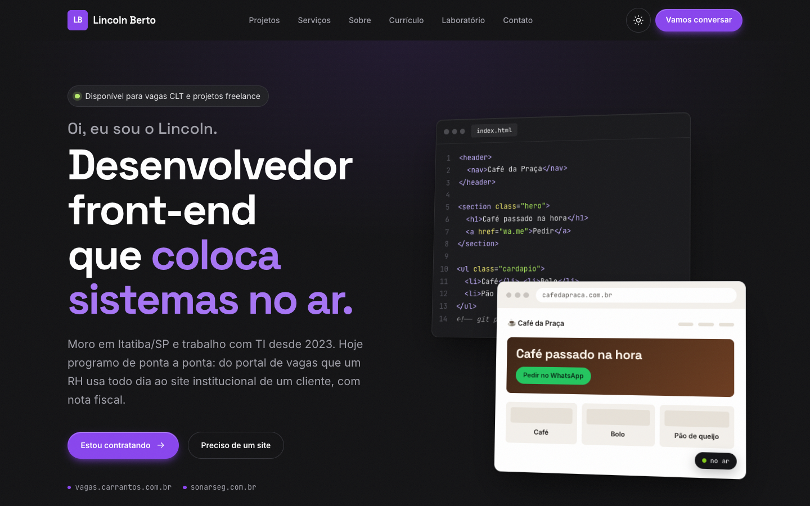
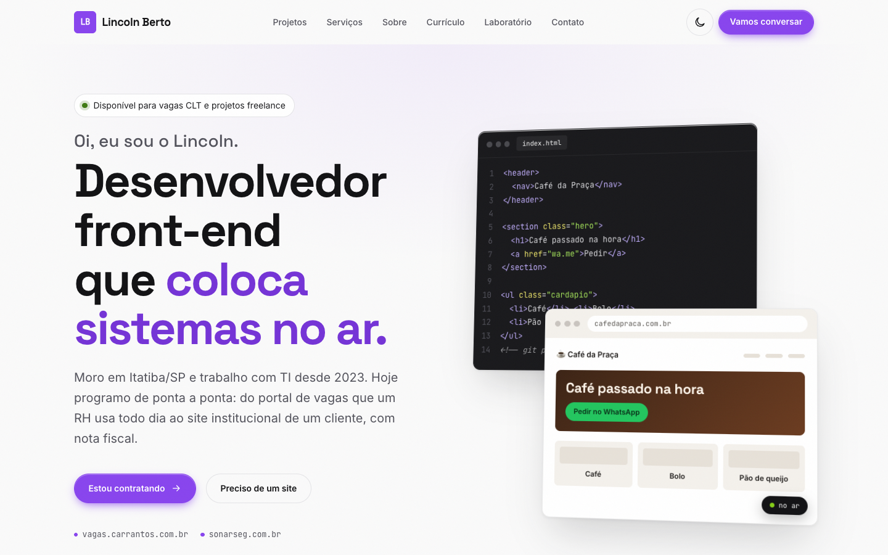
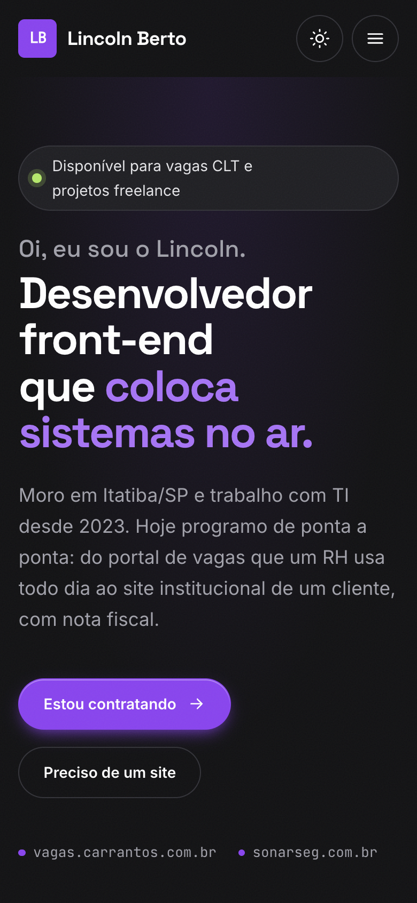

# ⚡ PORTFOLIO V3 — LINCOLN BERTO

> [!NOTE]
> **Engenharia de Interface & Marca Pessoal:** site estático multipágina, escrito em HTML, CSS e JavaScript puros, sem framework e sem etapa de build. Apresenta minha trajetória, cases de projetos em produção, serviços e currículo. A arquitetura segue Design Tokens, BEM e ES Modules, tem tema claro/escuro e é publicada na CDN da Vercel.

O site foi feito para recrutadores e para clientes. Recrutadores encontram cases, currículo e contato em poucos cliques. Clientes encontram os serviços e falam comigo direto pelo WhatsApp. Funciona em qualquer tamanho de tela.

---

## 🌐 Demonstração & Ambientes

- **Domínio Principal:** [https://www.lincolnberto.com](https://www.lincolnberto.com)
- **Domínio Nacional (Redirect):** [https://www.lincolnberto.com.br](https://www.lincolnberto.com.br)

<div align="center">
  <table>
    <tr>
      <td align="center" width="60%">
        <b>💻 Desktop (Escuro / Claro)</b><br><br>
        <br><br>
        
      </td>
      <td align="center" width="40%">
        <b>📱 Mobile</b><br><br>
        
      </td>
    </tr>
  </table>
</div>

---

## 🚀 Stack Tecnológica e Decisões de Arquitetura

Esta versão substitui a V2 em React. Para um site de conteúdo, a ideia foi tirar camadas que não estavam ajudando:

- **HTML, CSS e JavaScript puros:** o que está no repositório é o que vai para o navegador. Não tem dependência para instalar nem build que possa quebrar.
- **Design Tokens:** cores, fontes, espaçamentos e sombras ficam em variáveis no `:root` (`css/base/tokens.css`). A paleta vem do meu tema Origamid do VS Code.
- **CSS em camadas com BEM:** `base/`, `layout/` e `components/` são importados pelo `main.css`. O CSS que é de uma página só fica em `css/pages/` e só carrega naquela página.
- **ES Modules:** o `js/main.js` liga módulos pequenos e independentes: tema, menu, WhatsApp, animação do hero, linha do tempo e animações de entrada.
- **Tema sem piscada:** um script curto no `<head>` aplica o tema antes da página aparecer. Ele usa a escolha salva no `localStorage` ou, se não tiver nenhuma, a preferência do sistema (`prefers-color-scheme`).
- **Fontes locais:** Inter, Space Grotesk e JetBrains Mono em `woff2`, servidas pelo próprio site.
- **SEO:** cada página tem título, descrição, canonical e tags Open Graph próprias. O site também tem `sitemap.xml` e `robots.txt`.
- **Vercel:** hospedagem estática com SSL automático. Cada `git push` na `main` publica o site, e o `vercel.json` cuida das URLs com barra no final.

---

## 📝 Funcionalidades em Destaque

### 🎨 Interface

- **Hero animado:** um editor de código "escreve" um site e ele aparece pronto no navegador ao lado.
- **Cases de projetos:** páginas completas do ATS Carrantos, do Sonar e do Escuta e Cuida, com o problema, a solução, prints e o que cada projeto me ensinou.
- **Currículo em HTML:** página própria, pronta para imprimir ou salvar em PDF.
- **Laboratório:** estudos e projetos de curso, hospedados junto com o site em `meus-projetos/`.
- **WhatsApp integrado:** os botões montam o link do `wa.me` com uma mensagem pronta para cada contexto. O número fica em um só lugar (`js/config.js`).
- **Acessibilidade (A11y):** tags semânticas, link para pular direto ao conteúdo, navegação por teclado, textos para leitores de tela e respeito a `prefers-reduced-motion`.

---

## 🗂️ Estrutura

```
index.html                 home
projetos/                  lista de projetos e um case por pasta
sobre/  curriculo/  servicos/  laboratorio/  contato/
404.html
css/main.css               importa base/, layout/ e components/
css/pages/                 CSS de uma página só
js/main.js                 liga os módulos de js/modules/
js/config.js               número e mensagem do WhatsApp
img/  fonts/               imagens e fontes locais
meus-projetos/             projetos de estudo hospedados junto com o site
```

---

## 🛠️ Como Mexer

- **Rodar local:** `python3 -m http.server` e abrir http://localhost:8000. A página 404 só funciona na Vercel.
- **Cabeçalho, rodapé e ícones** estão copiados em todas as páginas. Mudou em uma, muda em todas.
- **Adicionar projeto:** copiar um `<article class="project">` em `projetos/index.html`.
- **Adicionar estudo:** copiar um `<li class="study">` em `laboratorio/index.html`.
- **Página nova:** copiar uma página parecida, trocar `<main>`, título, descrição, canonical e tags og, e incluir a URL no `sitemap.xml`.
- **Animação de entrada:** classes novas entram na lista `TARGETS` de `js/modules/reveal.js`.

---

## 👨‍💻 Autor

Desenvolvido por **Lincoln Berto**.

- **LinkedIn:** [https://www.linkedin.com/in/lincoln-berto/](https://www.linkedin.com/in/lincoln-berto/)
- **GitHub:** [https://github.com/eilincoln](https://github.com/eilincoln)
- **Portfólio:** [https://www.lincolnberto.com](https://www.lincolnberto.com)
